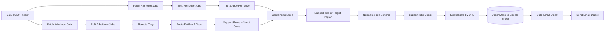

# Jobhunter AI Agent GitHub

[English](README.md) · **Deutsch** · [Italiano](README.it.md)

Ein [n8n](https://n8n.io/)-Workflow, der jeden Morgen Remote-Stellen im **IT-Support und Kundenservice** aus zwei öffentlichen Job-APIs sammelt, filtert, Dubletten entfernt, die Ergebnisse in Google Sheets speichert und eine tägliche E-Mail-Zusammenfassung verschickt.

> **Ehrlicher Umfang:** Jobhunter AI Agent wurde *mit* KI-Unterstützung entwickelt, der Workflow selbst ist jedoch regelbasiert (Schlüsselwortfilter mit regulären Ausdrücken und JavaScript). Er enthält kein KI-Modell und arbeitet nicht als autonomer KI-Agent; eine KI-gestützte Bewertung von Stellen ist auf der [Roadmap](#roadmap) geplant. Siehe [KI-gestützte Entwicklung](#ki-gestützte-entwicklung-ai-assisted-development).

## Überblick

Mehrere Jobbörsen täglich von Hand nach derselben Art von Stelle zu durchsuchen, ist monoton und liefert Dubletten sowie unpassende Treffer, etwa Vertriebsstellen, die „Customer Support“ erwähnen. Jobhunter AI Agent automatisiert diese Routine für ein konkretes Profil: Remote-Stellen im First-Level- und technischen Support sowie im Kundenservice, mit Schwerpunkt auf europäischen und italienischen Remote-Positionen.

Jeden Tag um 09:00 Uhr (Europe/Rome) führt der Workflow folgende Schritte aus:

1. Er ruft aktuelle Stellen über die öffentlichen APIs von **Arbeitnow** und **Remotive** ab,
2. behält nur passende Rollen und schließt Vertriebsstellen aus,
3. überführt beide Quellen in ein gemeinsames Datenschema und überspringt Einträge ohne gültigen Link,
4. entfernt Dubletten und schreibt die Ergebnisse per Upsert in ein **Google Sheet**,
5. verschickt eine kurze HTML-Zusammenfassung mit Titel, Unternehmen, Quelle und Link.

## Funktionen

Alle folgenden Funktionen sind in [`workflow/jobhunter-ai.json`](workflow/jobhunter-ai.json) umgesetzt und durch die Offline-Tests abgedeckt.

- **Zeitgesteuerter Lauf** – täglich um 09:00 Uhr, Zeitzone Europe/Rome.
- **Zwei Jobquellen** – Arbeitnow Job-Board-API und Remotive Remote-Jobs-API (keine API-Schlüssel nötig).
- **Vorfilter für Arbeitnow** – nur Remote-Stellen, höchstens 7 Tage alt (eigenes JavaScript auf Unix-Zeitstempeln).
- **Rollenfilter** – reguläre Ausdrücke für Helpdesk, Service Desk, IT-/technischen Support, First-Level-Support, Customer Service/Care, Callcenter, Inbound, E-Mail- und Chat-Support (zusätzlich deutsche Begriffe wie *Kundenservice*); Vertriebsrollen werden ausgeschlossen.
- **Robuste Normalisierung** – zehn Textfelder (`title, company, location, salary, job_type, language, remote_region, source, date, url`); fehlende oder unerwartete Werte brechen den Lauf nicht ab, Unix-Zeitstempel werden zu ISO 8601, und Stellen ohne gültige `http(s)`-URL werden übersprungen, weil die URL der eindeutige Schlüssel ist.
- **Dubletten-Erkennung** – innerhalb eines Laufs über die URL, über Läufe hinweg per Google-Sheets-*Append or Update* mit `url` als Schlüssel.
- **E-Mail-Zusammenfassung** – HTML-Mail mit Anzahl der Treffer und einem Eintrag pro Stelle; Jobdaten werden HTML-maskiert, und nur `http(s)`-Links werden ausgegeben.

## Architektur



17 ausführbare Nodes in einer linearen Pipeline mit zwei Quellzweigen. Details, Filterregeln und offene Designentscheidungen: [docs/architecture.de.md](docs/architecture.de.md).

## Technologien

| Bereich | Technologie |
|---|---|
| Automatisierung | n8n (selbst gehostet, entwickelt mit n8n 2.37.10), Execution Order v1 |
| Datenquellen | REST/JSON – Arbeitnow-API, Remotive-API |
| Logik | JavaScript (n8n-Code-Nodes), reguläre Ausdrücke, n8n Filter/Merge/Split Out/Set/Remove Duplicates |
| Speicherung | Google Sheets API (OAuth2), Upsert mit URL als Schlüssel |
| Benachrichtigung | SMTP-E-Mail mit generiertem HTML |
| Qualität | Integrierter Test-Runner von Node.js, Offline-Workflow-Simulator, Secret-Scanning, GitHub Actions |

## KI-gestützte Entwicklung (AI-Assisted Development)

Dies ist ein **KI-gestütztes Entwicklungsprojekt**. KI-Werkzeuge wurden genutzt, um das Projekt zu erstellen und zu prüfen; sie sind nicht Teil des laufenden Workflows.

| Phase | Einsatz von KI-Werkzeugen | Wie das Ergebnis geprüft wurde |
|---|---|---|
| Analyse und Planung | Prüfung des vorhandenen privaten n8n-Exports: Nodes, Verbindungen, Sicherheitsrisiken, Plan für die öffentliche Version | Jeder Schritt wurde geprüft und ausdrücklich freigegeben, bevor etwas geändert wurde |
| Umsetzung | Erzeugung des bereinigten Workflows, des JavaScripts der Code-Nodes und der Robustheitskorrekturen | 69 automatisierte Offline-Tests und Strukturprüfungen |
| Fehleranalyse | Ermittlung der Ursache ausgefallener zeitgesteuerter Läufe und von Verdrahtungsfehlern über lesende Prüfungen lokaler n8n-Daten und Systemprotokolle | Befunde beruhen auf aufgezeichneten Belegen, nicht auf Annahmen |
| Dokumentation | Entwurf der englischen, deutschen und italienischen Dokumentation | Automatische Prüfung von Links und identischer Struktur in allen drei Sprachen |
| Qualität und Sicherheit | Testsuite, Secret-Scanning, Abgleich mit den privaten Originalen | Wieder eingebaute Fehler werden von den Tests erkannt; kein privater Wert im Repository gefunden |

**Rollen.** Der Projektinhaber ([Levinci81](https://github.com/Levinci81)) hat Ziel und Anforderungen festgelegt, die Sicherheitsregeln vorgegeben (zuerst nur lesende Analyse, keine Änderungen an der produktiven Instanz, Freigabe vor jedem Schritt), über den Umfang entschieden (zum Beispiel die Entfernung zweier Datenquellen und die Veröffentlichung ohne Open-Source-Lizenz) und die Aktionen in der n8n-Oberfläche ausgeführt. Als KI-Assistent wurde Claude Code (Anthropic) eingesetzt; er hat Analyse, Codeänderungen, Tests und Dokumentationsentwürfe nach diesen Regeln erstellt. Der private Vorgänger (v2.0) bestand bereits, als diese KI-gestützte Überarbeitung begann.

## Projektstruktur

```text
jobhunter-ai/
├── workflow/jobhunter-ai.json     n8n-Workflow (bereinigt, importierbar)
├── config/                        Beispiel-Umgebung für n8n, Spaltenvorlage für Google Sheets
├── docs/                          Architektur, Einrichtung, Tests, Recruiter-Zusammenfassung (EN/DE/IT)
├── examples/                      Beispiel-E-Mail und Tabellenzeilen aus Testdaten
├── scripts/render-examples.mjs    erzeugt examples/ offline neu
├── tests/                         Offline-Tests, Simulator und künstliche Testdaten
├── SECURITY.md
└── CHANGELOG.md
```

## Schnellstart

1. `workflow/jobhunter-ai.json` in n8n importieren (*Workflows → Import from File*).
2. In n8n eine Google-Sheets-OAuth2- und eine SMTP-Zugangsberechtigung anlegen und in den beiden Nodes auswählen.
3. `YOUR_GOOGLE_SHEET_ID` und die `example.com`-Adressen ersetzen; die Kopfzeile aus [`config/google-sheet-columns.csv`](config/google-sheet-columns.csv) in das Sheet übernehmen.
4. Einmal manuell ausführen, Sheet und E-Mail prüfen, dann den Workflow aktivieren (veröffentlichen).

Schritt-für-Schritt-Anleitung inklusive eines sicheren ersten Tests: [docs/setup.de.md](docs/setup.de.md).

## Tests

```bash
npm test
```

Keine Abhängigkeiten zu installieren (Node.js ≥ 22). **69 Offline-Tests** prüfen die Workflow-Struktur, simulieren die gesamte Pipeline und einzelne Nodes mit künstlichen Daten (leere Ergebnisse, Dubletten, ungültige URLs, HTML-Sonderzeichen, fehlende Felder, fehlerhafte Datumsangaben, ungewöhnliche Regionsangaben, unerwartete API-Formate) **ohne jeden Netzwerkzugriff**, durchsuchen das Repository nach Geheimnissen und personenbezogenen Daten und halten die drei Sprachfassungen der Dokumentation synchron.

Die Tests führen das originale JavaScript der Code-Nodes aus, die übrigen n8n-Nodes werden simuliert. Zusätzlich lief die Workflow-Logik einmal in einer **isolierten n8n-2.37.10-Instanz** mit künstlichen Daten: Die Ausgaben aller 17 Nodes stimmten mit der Simulation überein. Echte API-Anfragen, Google Sheets und SMTP waren nicht Teil dieses Tests. Details: [docs/testing.de.md](docs/testing.de.md).

## Sicherheit

- In diesem Repository sind keine Zugangsdaten, Tokens, Cookies, persönlichen Adressen oder Sheet-IDs gespeichert; der Workflow nutzt Platzhalter und den Credential-Speicher von n8n.
- Frühere private Versionen enthielten eine Quelle, die ein Browser-Sitzungscookie in einem Request-Header verwendete. Sie wurde entfernt; die Lehre daraus ist in [SECURITY.md](SECURITY.md) dokumentiert.
- Empfohlene Härtung von n8n (Bindung an localhost, Bereinigung alter Ausführungen) steht in [`config/n8n.env.example`](config/n8n.env.example).

## Bekannte Einschränkungen

- Die Regionsbedingung ist mit der Titelprüfung per **ODER** verknüpft und wirkt daher nur bei Titeln, die der erste Titelfilter nicht erkennt; sie arbeitet mit Teilstrings, sodass `eu` z. B. auch *Deutschland* oder *Neuss* trifft.
- Der Vertriebsausschluss arbeitet mit Teilstrings, daher werden auch Titel wie *Salesforce Support* ausgeschlossen.
- Remotive-Stellen werden nicht nach Alter gefiltert (nur Arbeitnow-Stellen sind auf 7 Tage begrenzt).
- Die Zusammenfassung listet alle Treffer des Laufs, nicht nur seit dem letzten Lauf neue Stellen.
- Keine Wiederholungsversuche und kein Error-Workflow: Fällt eine API aus, bricht der Lauf ab und es wird keine E-Mail versendet.
- Die Klassifizierung basiert auf Schlüsselwörtern; der E-Mail-Text ist nur auf Deutsch.

Optionen und eine Empfehlung zu jedem Punkt: [offene Designentscheidungen](docs/architecture.de.md#offene-designentscheidungen).

## Roadmap

- v2.3 – Regionsregeln mit Wortgrenzen, Altersfilter für Remotive, Zusammenfassung nur neuer Stellen, Vertriebsausschluss mit Wortgrenzen.
- v2.4 – Wiederholungsversuche bei den API-Anfragen, Error-Workflow, einstellbare E-Mail-Sprache.
- Geplant: KI-gestützte Relevanzbewertung von Stellenbeschreibungen (noch nicht umgesetzt).

## Projektgeschichte

Version 2.2.0 ist die erste öffentliche Version. Sie basiert auf einem privaten Workflow mit vier Quellen; zwei davon wurden aus Sicherheits- und Nutzungsbedingungsgründen entfernt, außerdem wurden mehrere Verdrahtungs- und Robustheitsfehler behoben. Siehe [CHANGELOG.md](CHANGELOG.md).

## Copyright und Lizenz

Copyright (c) 2026 Levinci81. All rights reserved.

Dieses Repository ist öffentlich, damit das Projekt beurteilt werden kann, zum Beispiel von Recruitern und Arbeitgebern. **Es wird keine Open-Source-Lizenz erteilt.** Über das hinaus, was Gesetz und [GitHub-Nutzungsbedingungen](https://docs.github.com/en/site-policy/github-terms/github-terms-of-service) erlauben – GitHub-Nutzer dürfen öffentliche Repositories ansehen und auf GitHub forken –, darf niemand den Code ohne schriftliche Erlaubnis verwenden, kopieren, verändern oder weiterverbreiten (siehe auch [choosealicense.com: keine Lizenz](https://choosealicense.com/no-permission/)). Nur Konten mit Schreibrechten können dieses Repository verändern; Forks verändern das Original nicht.

Arbeitnow, Remotive, Google Sheets und n8n sind Produkte ihrer jeweiligen Inhaber; dieses Projekt steht in keiner Verbindung zu ihnen.
