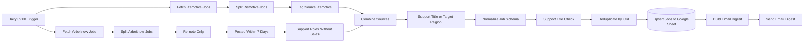

# Jobhunter AI Agent GitHub

[English](README.md) · [Deutsch](README.de.md) · **Italiano**

Un workflow [n8n](https://n8n.io/) che ogni mattina raccoglie offerte di lavoro da remoto nell'**assistenza IT e nel servizio clienti** da due API pubbliche, le filtra, elimina i duplicati, salva i risultati in Google Sheets e invia un riepilogo giornaliero via e-mail.

> **Ambito reale:** Jobhunter AI Agent è stato sviluppato *con* il supporto dell'IA, ma il workflow stesso è basato su regole (filtri per parole chiave con espressioni regolari e JavaScript). Non contiene alcun modello di IA e non agisce come agente IA autonomo; una valutazione delle offerte basata sull'IA è pianificata nella [roadmap](#roadmap). Vedi [Sviluppo assistito dall'IA](#sviluppo-assistito-dallia-ai-assisted-development).

## Panoramica

Cercare ogni giorno a mano lo stesso tipo di posizione su più portali è ripetitivo e produce duplicati e risultati non pertinenti, ad esempio posizioni commerciali che citano il "customer support". Jobhunter AI Agent automatizza questa routine per un profilo preciso: posizioni da remoto di supporto di primo livello e tecnico e di customer care, con attenzione alle offerte remote europee e italiane.

Ogni giorno alle 09:00 (Europe/Rome) il workflow:

1. recupera le offerte attuali dalle API pubbliche di **Arbeitnow** e **Remotive**,
2. mantiene solo i ruoli pertinenti ed esclude le posizioni commerciali,
3. converte entrambe le fonti in uno schema dati comune e salta le voci senza un link valido,
4. elimina i duplicati e scrive i risultati in un **Google Sheet** tramite upsert,
5. invia un breve riepilogo HTML con titolo, azienda, fonte e link.

## Funzionalità

Tutte le funzionalità seguenti sono implementate in [`workflow/jobhunter-ai.json`](workflow/jobhunter-ai.json) e coperte dai test offline.

- **Esecuzione pianificata** – ogni giorno alle 09:00, fuso orario Europe/Rome.
- **Due fonti** – API job board di Arbeitnow e API remote jobs di Remotive (nessuna chiave API necessaria).
- **Prefiltro Arbeitnow** – solo offerte da remoto, pubblicate negli ultimi 7 giorni (JavaScript personalizzato su timestamp Unix).
- **Filtro per ruolo** – espressioni regolari per helpdesk, service desk, supporto IT/tecnico, supporto di primo livello, customer service/care, call center, inbound, supporto via e-mail e chat (più termini tedeschi come *Kundenservice*); i ruoli commerciali sono esclusi.
- **Normalizzazione robusta** – dieci campi di testo (`title, company, location, salary, job_type, language, remote_region, source, date, url`); valori mancanti o inattesi non interrompono l'esecuzione, i timestamp Unix diventano ISO 8601 e le offerte senza un URL `http(s)` valido vengono saltate, perché l'URL è la chiave univoca.
- **Eliminazione dei duplicati** – all'interno di un'esecuzione tramite URL, tra esecuzioni diverse tramite *append or update* di Google Sheets con chiave `url`.
- **Riepilogo via e-mail** – e-mail HTML con il numero di risultati e una voce per offerta; i dati vengono sottoposti a escape HTML e vengono mostrati solo link `http(s)`.

## Architettura



17 nodi eseguibili in una pipeline lineare con due rami di origine. Dettagli, regole dei filtri e decisioni progettuali aperte: [docs/architecture.it.md](docs/architecture.it.md).

## Tecnologie

| Ambito | Tecnologia |
|---|---|
| Automazione | n8n (self-hosted, sviluppato con n8n 2.37.10), execution order v1 |
| Fonti dati | REST/JSON – API Arbeitnow, API Remotive |
| Logica | JavaScript (nodi Code di n8n), espressioni regolari, n8n Filter/Merge/Split Out/Set/Remove Duplicates |
| Archiviazione | Google Sheets API (OAuth2), upsert con chiave URL |
| Notifica | E-mail SMTP con HTML generato |
| Qualità | Test runner integrato di Node.js, simulatore offline del workflow, secret scanning, GitHub Actions |

## Sviluppo assistito dall'IA (AI-Assisted Development)

Questo è un **progetto di sviluppo assistito dall'IA**. Gli strumenti di IA sono stati usati per realizzare e verificare il progetto; non fanno parte del workflow in esecuzione.

| Fase | Uso degli strumenti di IA | Come è stato verificato il risultato |
|---|---|---|
| Analisi e pianificazione | Revisione dell'esportazione privata esistente di n8n: nodi, collegamenti, rischi di sicurezza, piano per la versione pubblica | Ogni passaggio è stato verificato e approvato esplicitamente prima di qualsiasi modifica |
| Implementazione | Generazione del workflow ripulito, del JavaScript dei nodi Code e delle correzioni di robustezza | 69 test offline automatizzati e controlli strutturali |
| Analisi dei problemi | Individuazione della causa delle esecuzioni pianificate mancate e degli errori di collegamento tramite controlli in sola lettura dei dati locali di n8n e dei log di sistema | I risultati si basano su evidenze registrate, non su ipotesi |
| Documentazione | Bozze della documentazione in inglese, tedesco e italiano | Controlli automatici di link e struttura identica nelle tre lingue |
| Qualità e sicurezza | Suite di test, secret scanning, confronto con gli originali privati | Gli errori reintrodotti vengono rilevati dai test; nessun valore privato trovato nel repository |

**Ruoli.** Il titolare del progetto ([Levinci81](https://github.com/Levinci81)) ha definito obiettivo e requisiti, stabilito le regole di sicurezza (prima solo analisi in lettura, nessuna modifica all'istanza di produzione, approvazione prima di ogni passaggio), deciso l'ambito (ad esempio la rimozione di due fonti e la pubblicazione senza licenza open source) ed eseguito le azioni nell'interfaccia di n8n. L'assistente di IA utilizzato è Claude Code (Anthropic); ha svolto analisi, modifiche al codice, test e bozze della documentazione secondo queste regole. Il predecessore privato (v2.0) esisteva già quando è iniziata questa revisione assistita dall'IA.

## Struttura del repository

```text
jobhunter-ai/
├── workflow/jobhunter-ai.json     workflow n8n (ripulito, pronto per l'importazione)
├── config/                        ambiente n8n di esempio, modello di colonne per Google Sheets
├── docs/                          architettura, installazione, test, sintesi per recruiter (EN/DE/IT)
├── examples/                      e-mail e righe di esempio generate dai dati di test
├── scripts/render-examples.mjs    rigenera examples/ offline
├── tests/                         test offline, simulatore e dati di test sintetici
├── SECURITY.md
└── CHANGELOG.md
```

## Avvio rapido

1. Importare `workflow/jobhunter-ai.json` in n8n (*Workflows → Import from File*).
2. Creare in n8n una credenziale Google Sheets OAuth2 e una credenziale SMTP e selezionarle nei due nodi.
3. Sostituire `YOUR_GOOGLE_SHEET_ID` e gli indirizzi `example.com`; aggiungere al foglio la riga di intestazione da [`config/google-sheet-columns.csv`](config/google-sheet-columns.csv).
4. Eseguire una volta manualmente, controllare foglio ed e-mail, poi attivare (pubblicare) il workflow.

Guida passo per passo, con un primo test sicuro: [docs/setup.it.md](docs/setup.it.md).

## Test

```bash
npm test
```

Nessuna dipendenza da installare (Node.js ≥ 22). **69 test offline** verificano la struttura del workflow, simulano l'intera pipeline e singoli nodi con dati sintetici (risultati vuoti, duplicati, URL non validi, caratteri speciali HTML, campi mancanti, date errate, regioni insolite, formati API inattesi) **senza alcun accesso alla rete**, cercano segreti e dati personali nel repository e mantengono allineate le tre lingue della documentazione.

I test eseguono il JavaScript originale dei nodi Code, mentre gli altri nodi n8n sono simulati. Inoltre la logica del workflow è stata eseguita una volta in un'**istanza n8n 2.37.10 isolata** con dati sintetici: gli output di tutti i 17 nodi coincidevano con la simulazione. Richieste API reali, Google Sheets e SMTP non facevano parte di quel test. Dettagli: [docs/testing.it.md](docs/testing.it.md).

## Sicurezza

- In questo repository non sono salvati credenziali, token, cookie, indirizzi personali o ID di fogli; il workflow usa segnaposto e l'archivio credenziali di n8n.
- Versioni private precedenti contenevano una fonte che usava un cookie di sessione del browser in un header della richiesta. È stata rimossa; la lezione appresa è documentata in [SECURITY.md](SECURITY.md).
- Le misure di hardening consigliate per n8n (binding su localhost, pulizia delle esecuzioni) sono in [`config/n8n.env.example`](config/n8n.env.example).

## Limitazioni note

- La condizione sulla regione è combinata in **OR** con il controllo del titolo, quindi conta solo per i titoli che il primo filtro non riconosce; usa la ricerca per sottostringa, per cui `eu` corrisponde anche, ad esempio, a *Deutschland* o *Neuss*.
- L'esclusione dei ruoli commerciali usa la ricerca per sottostringa, quindi vengono esclusi anche titoli come *Salesforce Support*.
- Le offerte Remotive non sono filtrate per età (solo quelle Arbeitnow sono limitate a 7 giorni).
- Il riepilogo elenca tutti i risultati dell'esecuzione, non solo le offerte nuove rispetto all'esecuzione precedente.
- Nessun nuovo tentativo e nessun error workflow: se un'API non risponde, l'esecuzione si interrompe e non viene inviata alcuna e-mail.
- La classificazione si basa su parole chiave; il testo dell'e-mail è solo in tedesco.

Opzioni e una raccomandazione per ogni punto: [decisioni progettuali aperte](docs/architecture.it.md#decisioni-progettuali-aperte).

## Roadmap

- v2.3 – regole per le regioni con confini di parola, filtro di età per Remotive, riepilogo solo delle nuove offerte, esclusione dei ruoli commerciali con confini di parola.
- v2.4 – nuovi tentativi per le richieste API, error workflow, lingua dell'e-mail configurabile.
- Pianificato: valutazione della pertinenza delle descrizioni tramite IA (non ancora implementata).

## Storia del progetto

La versione 2.2.0 è il primo rilascio pubblico. Si basa su un workflow privato con quattro fonti; due sono state rimosse per motivi di sicurezza e di termini di servizio, e sono stati corretti diversi errori di collegamento e di robustezza. Vedi [CHANGELOG.md](CHANGELOG.md).

## Copyright e licenza

Copyright (c) 2026 Levinci81. All rights reserved.

Questo repository è pubblico affinché il progetto possa essere valutato, ad esempio da recruiter e datori di lavoro. **Non viene concessa alcuna licenza open source.** Oltre a quanto consentito dalla legge e dai [Termini di servizio di GitHub](https://docs.github.com/en/site-policy/github-terms/github-terms-of-service) – gli utenti GitHub possono visualizzare i repository pubblici e farne un fork su GitHub –, nessuno può usare, copiare, modificare o ridistribuire il codice senza autorizzazione scritta (vedi anche [choosealicense.com: nessuna licenza](https://choosealicense.com/no-permission/)). Solo gli account con permessi di scrittura possono modificare questo repository; i fork non modificano l'originale.

Arbeitnow, Remotive, Google Sheets e n8n sono prodotti dei rispettivi titolari; questo progetto non è affiliato con loro.
