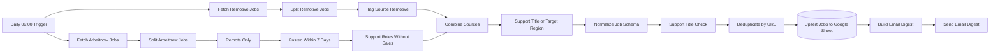

# Jobhunter AI Agent GitHub

**English** · [Deutsch](README.de.md) · [Italiano](README.it.md)

An [n8n](https://n8n.io/) workflow that collects remote **IT support and customer-service jobs** from two public job APIs every morning, filters and de-duplicates them, stores them in Google Sheets and sends a daily email digest.

> **Honest scope:** Jobhunter AI Agent was built *with* AI assistance, but the workflow itself is rule-based (keyword filters in regular expressions and JavaScript). It contains no AI model and does not act as an autonomous AI agent; AI-based job scoring is planned on the [roadmap](#roadmap). See [AI-Assisted Development](#ai-assisted-development).

## Overview

Searching several job boards by hand for the same kind of role is repetitive and produces duplicates and irrelevant hits, such as sales positions that mention "customer support". Jobhunter AI Agent automates that routine for one specific profile: remote first-level / technical support and customer-care positions, with a focus on European and Italian remote roles.

Every day at 09:00 (Europe/Rome) the workflow:

1. fetches current postings from the **Arbeitnow** and **Remotive** public APIs,
2. keeps only relevant roles and removes sales positions,
3. maps both sources to one common job schema and skips entries without a valid link,
4. removes duplicates and upserts the results into a **Google Sheet**,
5. emails a short HTML digest with title, company, source and link.

## Features

All features below are implemented in [`workflow/jobhunter-ai.json`](workflow/jobhunter-ai.json) and covered by the offline tests.

- **Scheduled run** – daily at 09:00, time zone Europe/Rome.
- **Two job sources** – Arbeitnow job-board API and Remotive remote-jobs API (no API keys required).
- **Arbeitnow pre-filter** – remote jobs only, posted within the last 7 days (custom JavaScript on Unix timestamps).
- **Role filter** – regular expressions for helpdesk, service desk, IT/technical support, first-level support, customer service/care, call center, inbound, email and chat support (plus German terms such as *Kundenservice*); sales roles are excluded.
- **Robust normalization** – ten text fields (`title, company, location, salary, job_type, language, remote_region, source, date, url`); missing or unexpected values do not stop the run, Unix timestamps become ISO 8601, and jobs without a valid `http(s)` URL are skipped because the URL is the unique key.
- **De-duplication** – within a run by URL, across runs through a Google Sheets *append or update* keyed on `url`.
- **Email digest** – HTML email with the number of matches and one entry per job; job data is HTML-escaped and only `http(s)` links are rendered.

## Architecture



17 executable nodes in one linear pipeline with two source branches. Details, filter rules and open design decisions: [docs/architecture.en.md](docs/architecture.en.md).

## Tech stack

| Area | Technology |
|---|---|
| Automation | n8n (self-hosted, built with n8n 2.37.10), execution order v1 |
| Data sources | REST/JSON – Arbeitnow API, Remotive API |
| Logic | JavaScript (n8n Code nodes), regular expressions, n8n Filter/Merge/Split Out/Set/Remove Duplicates |
| Storage | Google Sheets API (OAuth2), upsert keyed on URL |
| Notification | SMTP email with generated HTML |
| Quality | Node.js built-in test runner, offline workflow simulator, secret scanning, GitHub Actions |

## AI-Assisted Development

This is an **AI-assisted development project**. AI tools were used to build and check the project; they are not part of the running workflow.

| Phase | Use of AI tools | How the result was checked |
|---|---|---|
| Analysis and planning | Reviewing the existing private n8n export: nodes, connections, security risks, plan for the public version | Each step was reviewed and explicitly approved before anything was changed |
| Implementation | Generating the sanitized workflow, the JavaScript of the Code nodes and the robustness fixes | 69 automated offline tests and structural checks |
| Troubleshooting | Finding the cause of missed scheduled runs and of wiring bugs, using read-only checks of local n8n data and system logs | Findings are based on recorded evidence, not assumptions |
| Documentation | Drafting the English, German and Italian documentation | Automated checks for links and identical structure in all three languages |
| Quality and security | Test suite, secret scanning, comparison against the private originals | Re-introduced bugs are detected by the tests; no private value found in the repository |

**Roles.** The project owner ([Levinci81](https://github.com/Levinci81)) defined the goal and requirements, set the safety rules (read-only analysis first, no changes to the production instance, approval before every step), decided on the scope (for example removing two data sources and publishing without an open-source license) and performed the actions in the n8n user interface. The AI assistant used was Claude Code (Anthropic); it carried out the analysis, code changes, tests and documentation drafts under these rules. The private predecessor (v2.0) already existed when this AI-assisted review started.

## Repository structure

```text
jobhunter-ai/
├── workflow/jobhunter-ai.json     n8n workflow (sanitized, import-ready)
├── config/                        example n8n environment, Google Sheet column template
├── docs/                          architecture, setup, testing, recruiter summary (EN/DE/IT)
├── examples/                      sample email and sheet rows generated from test data
├── scripts/render-examples.mjs    regenerates examples/ offline
├── tests/                         offline tests, simulator and synthetic fixtures
├── SECURITY.md
└── CHANGELOG.md
```

## Quick start

1. Import `workflow/jobhunter-ai.json` in n8n (*Workflows → Import from File*).
2. Create a Google Sheets OAuth2 credential and an SMTP credential in n8n and select them in the two nodes.
3. Replace `YOUR_GOOGLE_SHEET_ID` and the `example.com` addresses; add the header row from [`config/google-sheet-columns.csv`](config/google-sheet-columns.csv) to your sheet.
4. Run it once manually, check the sheet and the email, then activate (publish) the workflow.

Step-by-step guide, including a safe first test: [docs/setup.en.md](docs/setup.en.md).

## Tests

```bash
npm test
```

No dependencies to install (Node.js ≥ 22). **69 offline tests** check the workflow structure, simulate the full pipeline and single nodes with synthetic data (empty results, duplicates, invalid URLs, HTML special characters, missing fields, invalid dates, odd region values, unexpected API formats) **without any network access**, scan the repository for secrets and personal data, and keep the three languages of the documentation in sync.

The tests run the original JavaScript of the Code nodes, while the other n8n nodes are simulated. In addition, the workflow logic was run once in an **isolated n8n 2.37.10 instance** with synthetic data: the outputs of all 17 nodes matched the simulation. Real API requests, Google Sheets and SMTP were not part of that test. Details: [docs/testing.en.md](docs/testing.en.md).

## Security

- No credentials, tokens, cookies, personal addresses or sheet IDs are stored in this repository; the workflow uses placeholders and n8n's credential store.
- Earlier private versions contained a source that relied on a browser session cookie in a request header. It was removed; the lesson is documented in [SECURITY.md](SECURITY.md).
- Recommended n8n hardening (bind to localhost, execution pruning) is in [`config/n8n.env.example`](config/n8n.env.example).

## Known limitations

- The region condition is combined with **OR** with the title check, so it only matters for titles that the first title filter does not recognise; it uses substring matching, so `eu` also matches e.g. *Deutschland* or *Neuss*.
- The sales exclusion is a substring match, so titles such as *Salesforce Support* are excluded as well.
- Remotive jobs are not filtered by age (only Arbeitnow jobs are limited to 7 days).
- The digest lists all matches of the run, not only jobs that are new since the previous run.
- No retry and no error workflow: if one API fails, the run stops and no email is sent.
- Classification is keyword-based; the email text is German only.

Options and a recommendation for each point: [open design decisions](docs/architecture.en.md#open-design-decisions).

## Roadmap

- v2.3 – region rules with word boundaries, age filter for Remotive, digest of new jobs only, sales exclusion with word boundaries.
- v2.4 – retries on the API requests, error workflow, configurable email language.
- Planned: AI-based relevance scoring of job descriptions (not implemented yet).

## Project history

Version 2.2.0 is the first public release. It is based on a private workflow that used four sources; two of them were removed for security and terms-of-service reasons, and several wiring and robustness bugs were fixed. See [CHANGELOG.md](CHANGELOG.md).

## Copyright and license

Copyright (c) 2026 Levinci81. All rights reserved.

This repository is public so that the project can be reviewed, for example by recruiters and employers. **No open-source license is granted.** Apart from what the law and [GitHub's Terms of Service](https://docs.github.com/en/site-policy/github-terms/github-terms-of-service) allow – GitHub users may view public repositories and fork them on GitHub – no one may use, copy, modify or redistribute the code without written permission (see also [choosealicense.com: no license](https://choosealicense.com/no-permission/)). Only accounts with write access can change this repository; forks do not change the original.

Arbeitnow, Remotive, Google Sheets and n8n are products of their respective owners; this project is not affiliated with them.
