# Architektur

[English](architecture.en.md) · **Deutsch** · [Italiano](architecture.it.md) · [Zurück zur README](../README.de.md)

## Überblick

Jobhunter AI Agent ist ein einzelner n8n-Workflow ([`workflow/jobhunter-ai.json`](../workflow/jobhunter-ai.json)) mit 17 ausführbaren Nodes und einer Notiz mit Einrichtungshinweisen. Zwei Quellzweige (Remotive und Arbeitnow) werden zu einer linearen Verarbeitungspipeline zusammengeführt, die in Google Sheets und einer E-Mail endet. Der Workflow nutzt die n8n-Execution-Order v1 und die Zeitzone Europe/Rome.

## Datenfluss

```mermaid
flowchart LR
  T[Daily 09:00 Trigger] --> R1[Fetch Remotive Jobs] --> R2[Split Remotive Jobs] --> R3[Tag Source Remotive] -->|input 0| M[Combine Sources]
  T --> A1[Fetch Arbeitnow Jobs] --> A2[Split Arbeitnow Jobs] --> A3[Remote Only] --> A4[Posted Within 7 Days] --> A5[Support Roles Without Sales] -->|input 1| M
  M --> F1[Support Title or Target Region] --> N[Normalize Job Schema] --> F2[Support Title Check] --> D[Deduplicate by URL] --> S[(Upsert Jobs to Google Sheet)] --> B[Build Email Digest] --> E[Send Email Digest]
```



Lässt ein Filter keine Einträge durch, führt n8n die nachfolgenden Nodes nicht aus: An einem Tag ohne Treffer wird nichts geschrieben und keine E-Mail versendet.

## Nodes

| # | Node | Typ | Zweck |
|---|---|---|---|
| 1 | Daily 09:00 Trigger | Schedule Trigger | Startet den Lauf täglich um 09:00 Uhr (Zeitzone des Workflows). |
| 2 | Fetch Arbeitnow Jobs | HTTP Request | `GET https://www.arbeitnow.com/api/job-board-api` |
| 3 | Split Arbeitnow Jobs | Split Out | Ein Eintrag pro Element des Arrays `data`. |
| 4 | Remote Only | Filter | `remote` ist der Boolean-Wert `true`; Texte wie `"true"` und fehlende Werte werden verworfen. |
| 5 | Posted Within 7 Days | Code | Behält Stellen, deren `created_at` (Unix-Sekunden) in den letzten 7 Tagen und nicht in der Zukunft liegt. |
| 6 | Support Roles Without Sales | Filter | Rollen-Schlüsselwörter in Titel + Beschreibung; Vertriebsbegriffe im Titel schließen die Stelle aus; fehlende Felder gelten als leerer Text. |
| 7 | Fetch Remotive Jobs | HTTP Request | `GET https://remotive.com/api/remote-jobs` |
| 8 | Split Remotive Jobs | Split Out | Ein Eintrag pro Element des Arrays `jobs`. |
| 9 | Tag Source Remotive | Set | Ergänzt `source = "remotive"` und behält alle übrigen Felder. |
| 10 | Combine Sources | Merge (Append) | Eingang 0: Remotive, Eingang 1: Arbeitnow. |
| 11 | Support Title or Target Region | Filter (ODER) | Rollen-Schlüsselwörter im Titel **oder** eine Zielregion im Ort. |
| 12 | Normalize Job Schema | Code | Überführt beide Quellen in das Textschema mit zehn Feldern, wandelt Unix-Zeitstempel in ISO 8601 um und verwirft Stellen ohne gültige `http(s)`-URL. |
| 13 | Support Title Check | Filter | Rollen-Schlüsselwörter (inkl. deutscher Begriffe) im normalisierten Titel. |
| 14 | Deduplicate by URL | Remove Duplicates | Behält den ersten Eintrag pro `url`; Remotive hat Vorrang, weil es Merge-Eingang 0 ist. |
| 15 | Upsert Jobs to Google Sheet | Google Sheets | *Append or Update* mit Abgleichsspalte `url`. |
| 16 | Build Email Digest | Code | Erzeugt Betreff und HTML-Text; maskiert Jobdaten, gibt nur `http(s)`-Links aus. |
| 17 | Send Email Digest | Send Email (SMTP) | Versendet die Zusammenfassung. |

## Datenschema

| Feld | Quellfeld Arbeitnow | Quellfeld Remotive |
|---|---|---|
| `title` | `title` | `title` |
| `company` | `company_name` | `company_name` |
| `location` | `location` | `candidate_required_location` |
| `salary` | – (leer) | `salary` |
| `job_type` | `job_types` | `job_type` |
| `language` | – (leer) | – (leer) |
| `remote_region` | `location` | `candidate_required_location` |
| `source` | `"arbeitnow"` (Standardwert) | `"remotive"` (in Node 9 gesetzt) |
| `date` | `created_at` → ISO 8601 | `publication_date` (unverändert) |
| `url` | `url` | `url` |

Die Spalte `language` ist für eine spätere Verwendung im Schema vorgesehen; keine der beiden APIs liefert sie derzeit. Alle Felder sind Text: Arrays (zum Beispiel Arbeitnow `job_types`) werden mit `, ` verbunden, Objekte und fehlende Werte werden zu leerem Text, und ungültige Datumsangaben werden zu leerem Text, statt den Lauf abzubrechen.

## Filterregeln

Die exakten Ausdrücke der drei Schlüsselwortfilter:

```text
Support Roles Without Sales   (lower-cased title + " " + description, case-sensitive)
  include: (helpdesk|service desk|it support|technical support|tech support|first level support|
            1st level support|customer support|customer service|customer care|call center|call centre|
            inbound|email support|chat support)
  exclude (title): (sales|account executive|account manager|business development|sales manager|
            sales representative)

Support Title or Target Region   (case-insensitive, conditions combined with OR)
  title:    (helpdesk|service desk|it support|technical support|tech support|first level support|
            1st level support|customer support|customer service|customer care|call center|call centre|
            inbound|email support|e-mail support|chat support)
  location: contains "italy" | "europe" | "worldwide" | "eu" | "eea"

Support Title Check   (normalized title, case-insensitive)
  include: (helpdesk|service desk|it support|technical support|tech support|first level|1st level|
            customer support|customer service|customer care|kundenservice|kundendienst|call center|
            call centre|inbound|email support|e-mail support|chat support)
```

## Designentscheidungen

- **Keine Geheimnisse in der Workflow-Datei.** Google Sheets und SMTP nutzen n8n-Credentials, die nach dem Import ausgewählt werden; die Datei enthält nur Platzhalter.
- **Idempotente Speicherung.** Das Sheet wird per *Append or Update* über `url` aktualisiert, wiederholte Läufe erzeugen keine doppelten Zeilen.
- **Vorrang der Quellen.** Remotive ist Merge-Eingang 0; führen beide Quellen dieselbe URL, bleibt der Remotive-Eintrag erhalten.
- **Defensive E-Mail-Ausgabe.** Jobdaten stammen von Dritten; sie werden HTML-maskiert, und nur `http(s)`-Links werden ausgegeben.
- **Sprechende Node-Namen.** Jeder Node-Name beschreibt seine Aufgabe; Ausführungen und Fehler bleiben so nachvollziehbar.

## Offene Designentscheidungen

Diese Punkte sind bekannte Einschränkungen. Das gewünschte Verhalten ist nicht eindeutig festgelegt, daher wurden sie dokumentiert statt geändert. Jede Empfehlung bräuchte eigene Tests und einen Live-Test in n8n.

| Thema | Optionen | Empfehlung |
|---|---|---|
| Regionsfilter | (a) Titel **oder** Region beibehalten; (b) Titel **und** Region; (c) Regionsregel nur dort, wo die API ein Regionsfeld liefert, mit Ganzwortvergleich | (c): eine Regionsliste mit Ganzwortvergleich (Italy, Europe, EU, EEA, Worldwide) auf `candidate_required_location` von Remotive anwenden; Arbeitnow bleibt auf Remote-Stellen beschränkt |
| Vertriebsausschluss | (a) Teilstring-Vergleich; (b) Ganzwortvergleich (`\bsales\b`) | (b), damit Rollen wie *Salesforce Support* nicht mehr ausgeschlossen werden |
| Alter der Remotive-Stellen | (a) keine Grenze; (b) dasselbe 7-Tage-Fenster auf `publication_date` | (b), mit der Logik von *Posted Within 7 Days* |
| Nur neue Stellen | (a) alle Treffer mailen; (b) vorhandene URLs zuerst im Sheet nachschlagen; (c) n8n *Remove Duplicates* über Ausführungen hinweg | (c), sofern die eingesetzte n8n-Version es unterstützt, sonst (b) |
| Fehlerbehandlung | (a) wie bisher; (b) *Retry On Fail* an beiden HTTP-Nodes; (c) zusätzlich ein Error-Workflow, der fehlgeschlagene Läufe meldet | (b) + (c) |
| E-Mail-Sprache | (a) nur Deutsch; (b) Sprache als Parameter in einem Set-Node | (a), bis tatsächlich eine weitere Sprache gebraucht wird |
## Änderungen gegenüber der privaten Version

- Eine authentifizierte Jobportal-Quelle entfernt, die ein Sitzungscookie in einem Request-Header verwendete.
- Eine HTML-Scraping-Quelle samt Merge-Pfad entfernt.
- Eine Verbindung korrigiert, die Remotive-Stellen in beide Merge-Eingänge einspeiste (jede Remotive-Stelle wurde doppelt verarbeitet).
- Einen Pfad korrigiert, der ungefilterte Arbeitnow-Stellen direkt in die E-Mail schickte und so die Rollenfilter umging.
- Zwei Nodes ohne Weiterverarbeitung und einen Filter mit stets wahrer Bedingung entfernt.
- HTML-Maskierung und URL-Prüfung in der E-Mail sowie Umwandlung von Unix-Zeitstempeln in ISO 8601 ergänzt.
- Filter und Normalisierung robust gegen fehlende Felder und unerwartete Datentypen gemacht; Stellen ohne gültige `http(s)`-URL werden verworfen.
