# Architecture

**English** · [Deutsch](architecture.de.md) · [Italiano](architecture.it.md) · [Back to README](../README.md)

## Overview

Jobhunter AI Agent is a single n8n workflow ([`workflow/jobhunter-ai.json`](../workflow/jobhunter-ai.json)) with 17 executable nodes and one sticky note with setup hints. Two source branches (Remotive and Arbeitnow) are merged into one linear processing pipeline that ends in Google Sheets and an email. The workflow uses n8n execution order v1 and the time zone Europe/Rome.

## Data flow

```mermaid
flowchart LR
  T[Daily 09:00 Trigger] --> R1[Fetch Remotive Jobs] --> R2[Split Remotive Jobs] --> R3[Tag Source Remotive] -->|input 0| M[Combine Sources]
  T --> A1[Fetch Arbeitnow Jobs] --> A2[Split Arbeitnow Jobs] --> A3[Remote Only] --> A4[Posted Within 7 Days] --> A5[Support Roles Without Sales] -->|input 1| M
  M --> F1[Support Title or Target Region] --> N[Normalize Job Schema] --> F2[Support Title Check] --> D[Deduplicate by URL] --> S[(Upsert Jobs to Google Sheet)] --> B[Build Email Digest] --> E[Send Email Digest]
```



If a filter lets no items through, n8n does not execute the following nodes: on a day without matches nothing is written and no email is sent.

## Nodes

| # | Node | Type | Purpose |
|---|---|---|---|
| 1 | Daily 09:00 Trigger | Schedule Trigger | Starts the run every day at 09:00 (workflow time zone). |
| 2 | Fetch Arbeitnow Jobs | HTTP Request | `GET https://www.arbeitnow.com/api/job-board-api` |
| 3 | Split Arbeitnow Jobs | Split Out | One item per entry of the `data` array. |
| 4 | Remote Only | Filter | `remote` is the boolean `true`; strings such as `"true"` and missing values are dropped. |
| 5 | Posted Within 7 Days | Code | Keeps jobs whose `created_at` (Unix seconds) lies within the last 7 days and not in the future. |
| 6 | Support Roles Without Sales | Filter | Role keywords in title + description; sales terms in the title exclude the job; missing fields count as empty text. |
| 7 | Fetch Remotive Jobs | HTTP Request | `GET https://remotive.com/api/remote-jobs` |
| 8 | Split Remotive Jobs | Split Out | One item per entry of the `jobs` array. |
| 9 | Tag Source Remotive | Set | Adds `source = "remotive"` and keeps all other fields. |
| 10 | Combine Sources | Merge (append) | Input 0: Remotive, input 1: Arbeitnow. |
| 11 | Support Title or Target Region | Filter (OR) | Role keywords in the title **or** a target region in the location. |
| 12 | Normalize Job Schema | Code | Maps both sources to the ten-field text schema, converts Unix timestamps to ISO 8601 and drops jobs without a valid `http(s)` URL. |
| 13 | Support Title Check | Filter | Role keywords (incl. German terms) in the normalized title. |
| 14 | Deduplicate by URL | Remove Duplicates | Keeps the first item per `url`; Remotive wins because it is merge input 0. |
| 15 | Upsert Jobs to Google Sheet | Google Sheets | *Append or update* with matching column `url`. |
| 16 | Build Email Digest | Code | Builds subject and HTML body; escapes job data, renders only `http(s)` links. |
| 17 | Send Email Digest | Send Email (SMTP) | Sends the digest. |

## Data schema

| Field | Arbeitnow source field | Remotive source field |
|---|---|---|
| `title` | `title` | `title` |
| `company` | `company_name` | `company_name` |
| `location` | `location` | `candidate_required_location` |
| `salary` | – (empty) | `salary` |
| `job_type` | `job_types` | `job_type` |
| `language` | – (empty) | – (empty) |
| `remote_region` | `location` | `candidate_required_location` |
| `source` | `"arbeitnow"` (default) | `"remotive"` (set in node 9) |
| `date` | `created_at` → ISO 8601 | `publication_date` (unchanged) |
| `url` | `url` | `url` |

The column `language` is part of the schema for later use; neither API provides it today. All fields are text: arrays (for example Arbeitnow `job_types`) are joined with `, `, objects and missing values become empty text, and invalid dates become empty text instead of stopping the run.

## Filter rules

The exact expressions used by the three keyword filters:

```text
Support Roles Without Sales   (lower-cased title + " " + description, case-sensitive)
  include: (helpdesk|service desk|it support|technical support|tech support|first level support|
            1st level support|customer support|customer service|customer care|call center|call centre|
            inbound|email support|chat support)
  exclude (title): (sales|account executive|account manager|business development|sales manager|
            sales representative)

Support Title or Target Region   (case-insensitive, conditions combined with OR)
  title:    (helpdesk|service desk|it support|technical support|tech support|first level support|
            1st level support|customer support|customer service|customer care|call center|call centre|
            inbound|email support|e-mail support|chat support)
  location: contains "italy" | "europe" | "worldwide" | "eu" | "eea"

Support Title Check   (normalized title, case-insensitive)
  include: (helpdesk|service desk|it support|technical support|tech support|first level|1st level|
            customer support|customer service|customer care|kundenservice|kundendienst|call center|
            call centre|inbound|email support|e-mail support|chat support)
```

## Design decisions

- **No secrets in the workflow file.** Google Sheets and SMTP use n8n credentials that are selected after import; the file only contains placeholders.
- **Idempotent storage.** The sheet is updated with *append or update* on `url`, so repeated runs do not create duplicate rows.
- **Source precedence.** Remotive is merge input 0, so when both sources list the same URL the Remotive entry is kept.
- **Defensive email rendering.** Job data comes from third parties; it is HTML-escaped and only `http(s)` links are rendered.
- **Descriptive node names.** Each node name states what it does, which keeps executions and errors readable.

## Open design decisions

These points are known limitations. The intended behaviour is not specified unambiguously, so they were documented instead of changed. Each recommendation would need its own tests and a live test in n8n.

| Topic | Options | Recommendation |
|---|---|---|
| Region filter | (a) keep title **or** region; (b) title **and** region; (c) region rule only where the API provides a region field, with whole-word matching | (c): apply a whole-word region list (Italy, Europe, EU, EEA, Worldwide) to Remotive's `candidate_required_location`; keep Arbeitnow limited to remote jobs |
| Sales exclusion | (a) substring match; (b) whole-word match (`\bsales\b`) | (b), so that roles such as *Salesforce Support* are no longer excluded |
| Age of Remotive jobs | (a) no limit; (b) the same 7-day window on `publication_date` | (b), reusing the logic of *Posted Within 7 Days* |
| New jobs only | (a) email all matches; (b) look up existing URLs in the sheet first; (c) n8n *Remove Duplicates* across executions | (c) if supported by the n8n version in use, otherwise (b) |
| Failure handling | (a) as is; (b) *Retry On Fail* on both HTTP nodes; (c) plus an error workflow that reports failed runs | (b) + (c) |
| Email language | (a) German only; (b) language as a parameter in a Set node | (a) until another language is actually needed |
## Changes compared with the private version

- Removed an authenticated job-portal source that relied on a session cookie in a request header.
- Removed an HTML-scraping source and its merge path.
- Fixed a connection that fed Remotive jobs into both merge inputs (every Remotive job was processed twice).
- Fixed a path that sent unfiltered Arbeitnow jobs directly into the email, bypassing the role filters.
- Removed two dead-end nodes and a filter whose condition was always true.
- Added HTML escaping and URL checks to the email and ISO 8601 conversion of Unix timestamps.
- Made the filters and the normalization robust against missing fields and unexpected data types; jobs without a valid `http(s)` URL are dropped.
