# Architettura

[English](architecture.en.md) · [Deutsch](architecture.de.md) · **Italiano** · [Torna al README](../README.it.md)

## Panoramica

Jobhunter AI Agent è un unico workflow n8n ([`workflow/jobhunter-ai.json`](../workflow/jobhunter-ai.json)) con 17 nodi eseguibili e una nota con indicazioni di configurazione. Due rami di origine (Remotive e Arbeitnow) confluiscono in una pipeline di elaborazione lineare che termina in Google Sheets e in un'e-mail. Il workflow usa l'execution order v1 di n8n e il fuso orario Europe/Rome.

## Flusso dei dati

```mermaid
flowchart LR
  T[Daily 09:00 Trigger] --> R1[Fetch Remotive Jobs] --> R2[Split Remotive Jobs] --> R3[Tag Source Remotive] -->|input 0| M[Combine Sources]
  T --> A1[Fetch Arbeitnow Jobs] --> A2[Split Arbeitnow Jobs] --> A3[Remote Only] --> A4[Posted Within 7 Days] --> A5[Support Roles Without Sales] -->|input 1| M
  M --> F1[Support Title or Target Region] --> N[Normalize Job Schema] --> F2[Support Title Check] --> D[Deduplicate by URL] --> S[(Upsert Jobs to Google Sheet)] --> B[Build Email Digest] --> E[Send Email Digest]
```



Se un filtro non lascia passare alcun elemento, n8n non esegue i nodi successivi: in un giorno senza risultati non viene scritto nulla e non viene inviata alcuna e-mail.

## Nodi

| # | Nodo | Tipo | Scopo |
|---|---|---|---|
| 1 | Daily 09:00 Trigger | Schedule Trigger | Avvia l'esecuzione ogni giorno alle 09:00 (fuso orario del workflow). |
| 2 | Fetch Arbeitnow Jobs | HTTP Request | `GET https://www.arbeitnow.com/api/job-board-api` |
| 3 | Split Arbeitnow Jobs | Split Out | Un elemento per ogni voce dell'array `data`. |
| 4 | Remote Only | Filter | `remote` è il valore booleano `true`; testi come `"true"` e valori mancanti vengono scartati. |
| 5 | Posted Within 7 Days | Code | Mantiene le offerte il cui `created_at` (secondi Unix) rientra negli ultimi 7 giorni e non è nel futuro. |
| 6 | Support Roles Without Sales | Filter | Parole chiave del ruolo in titolo + descrizione; termini commerciali nel titolo escludono l'offerta; i campi mancanti valgono come testo vuoto. |
| 7 | Fetch Remotive Jobs | HTTP Request | `GET https://remotive.com/api/remote-jobs` |
| 8 | Split Remotive Jobs | Split Out | Un elemento per ogni voce dell'array `jobs`. |
| 9 | Tag Source Remotive | Set | Aggiunge `source = "remotive"` e mantiene tutti gli altri campi. |
| 10 | Combine Sources | Merge (append) | Input 0: Remotive, input 1: Arbeitnow. |
| 11 | Support Title or Target Region | Filter (OR) | Parole chiave del ruolo nel titolo **oppure** una regione di destinazione nella località. |
| 12 | Normalize Job Schema | Code | Converte entrambe le fonti nello schema testuale a dieci campi, trasforma i timestamp Unix in ISO 8601 e scarta le offerte senza un URL `http(s)` valido. |
| 13 | Support Title Check | Filter | Parole chiave del ruolo (inclusi termini tedeschi) nel titolo normalizzato. |
| 14 | Deduplicate by URL | Remove Duplicates | Mantiene il primo elemento per `url`; prevale Remotive perché è l'input 0 del merge. |
| 15 | Upsert Jobs to Google Sheet | Google Sheets | *Append or update* con colonna di corrispondenza `url`. |
| 16 | Build Email Digest | Code | Crea oggetto e corpo HTML; esegue l'escape dei dati e mostra solo link `http(s)`. |
| 17 | Send Email Digest | Send Email (SMTP) | Invia il riepilogo. |

## Schema dei dati

| Campo | Campo di origine Arbeitnow | Campo di origine Remotive |
|---|---|---|
| `title` | `title` | `title` |
| `company` | `company_name` | `company_name` |
| `location` | `location` | `candidate_required_location` |
| `salary` | – (vuoto) | `salary` |
| `job_type` | `job_types` | `job_type` |
| `language` | – (vuoto) | – (vuoto) |
| `remote_region` | `location` | `candidate_required_location` |
| `source` | `"arbeitnow"` (predefinito) | `"remotive"` (impostato nel nodo 9) |
| `date` | `created_at` → ISO 8601 | `publication_date` (invariato) |
| `url` | `url` | `url` |

La colonna `language` è prevista nello schema per un uso futuro; attualmente nessuna delle due API la fornisce. Tutti i campi sono testo: gli array (ad esempio `job_types` di Arbeitnow) vengono uniti con `, `, oggetti e valori mancanti diventano testo vuoto e le date non valide diventano testo vuoto invece di interrompere l'esecuzione.

## Regole dei filtri

Le espressioni esatte dei tre filtri per parole chiave:

```text
Support Roles Without Sales   (lower-cased title + " " + description, case-sensitive)
  include: (helpdesk|service desk|it support|technical support|tech support|first level support|
            1st level support|customer support|customer service|customer care|call center|call centre|
            inbound|email support|chat support)
  exclude (title): (sales|account executive|account manager|business development|sales manager|
            sales representative)

Support Title or Target Region   (case-insensitive, conditions combined with OR)
  title:    (helpdesk|service desk|it support|technical support|tech support|first level support|
            1st level support|customer support|customer service|customer care|call center|call centre|
            inbound|email support|e-mail support|chat support)
  location: contains "italy" | "europe" | "worldwide" | "eu" | "eea"

Support Title Check   (normalized title, case-insensitive)
  include: (helpdesk|service desk|it support|technical support|tech support|first level|1st level|
            customer support|customer service|customer care|kundenservice|kundendienst|call center|
            call centre|inbound|email support|e-mail support|chat support)
```

## Scelte progettuali

- **Nessun segreto nel file del workflow.** Google Sheets e SMTP usano credenziali n8n selezionate dopo l'importazione; il file contiene solo segnaposto.
- **Archiviazione idempotente.** Il foglio viene aggiornato con *append or update* su `url`, quindi esecuzioni ripetute non creano righe duplicate.
- **Precedenza delle fonti.** Remotive è l'input 0 del merge: se entrambe le fonti riportano lo stesso URL, resta la voce di Remotive.
- **Rendering difensivo dell'e-mail.** I dati provengono da terzi; viene eseguito l'escape HTML e sono mostrati solo link `http(s)`.
- **Nomi dei nodi descrittivi.** Ogni nome indica cosa fa il nodo, così esecuzioni ed errori restano leggibili.

## Decisioni progettuali aperte

Questi punti sono limitazioni note. Il comportamento desiderato non è definito in modo univoco, perciò sono stati documentati invece che modificati. Ogni raccomandazione richiederebbe test propri e un test dal vivo in n8n.

| Tema | Opzioni | Raccomandazione |
|---|---|---|
| Filtro per regione | (a) mantenere titolo **o** regione; (b) titolo **e** regione; (c) regola sulla regione solo dove l'API fornisce un campo regione, con corrispondenza a parola intera | (c): applicare un elenco di regioni a parola intera (Italy, Europe, EU, EEA, Worldwide) a `candidate_required_location` di Remotive; Arbeitnow resta limitato alle offerte da remoto |
| Esclusione commerciale | (a) corrispondenza per sottostringa; (b) a parola intera (`\bsales\b`) | (b), così ruoli come *Salesforce Support* non vengono più esclusi |
| Età delle offerte Remotive | (a) nessun limite; (b) la stessa finestra di 7 giorni su `publication_date` | (b), riutilizzando la logica di *Posted Within 7 Days* |
| Solo offerte nuove | (a) inviare tutti i risultati; (b) cercare prima gli URL già presenti nel foglio; (c) *Remove Duplicates* di n8n tra esecuzioni | (c) se supportato dalla versione di n8n in uso, altrimenti (b) |
| Gestione degli errori | (a) come ora; (b) *Retry On Fail* su entrambi i nodi HTTP; (c) in più un error workflow che segnala le esecuzioni fallite | (b) + (c) |
| Lingua dell'e-mail | (a) solo tedesco; (b) lingua come parametro in un nodo Set | (a) finché non serve davvero un'altra lingua |
## Modifiche rispetto alla versione privata

- Rimossa una fonte di un portale autenticato che usava un cookie di sessione in un header della richiesta.
- Rimossa una fonte basata su scraping HTML con il relativo percorso di merge.
- Corretto un collegamento che inviava le offerte Remotive in entrambi gli input del merge (ogni offerta veniva elaborata due volte).
- Corretto un percorso che inviava offerte Arbeitnow non filtrate direttamente all'e-mail, aggirando i filtri sul ruolo.
- Rimossi due nodi senza seguito e un filtro con condizione sempre vera.
- Aggiunti escape HTML e controllo degli URL nell'e-mail e conversione dei timestamp Unix in ISO 8601.
- Resi robusti filtri e normalizzazione contro campi mancanti e tipi di dati inattesi; le offerte senza un URL `http(s)` valido vengono scartate.
